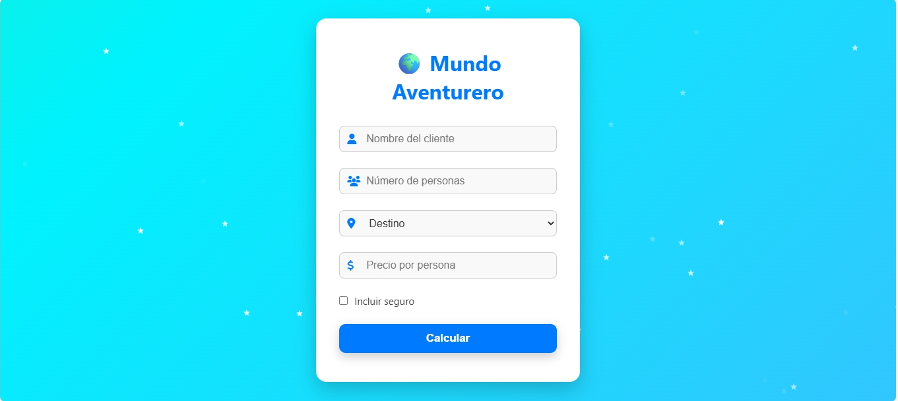
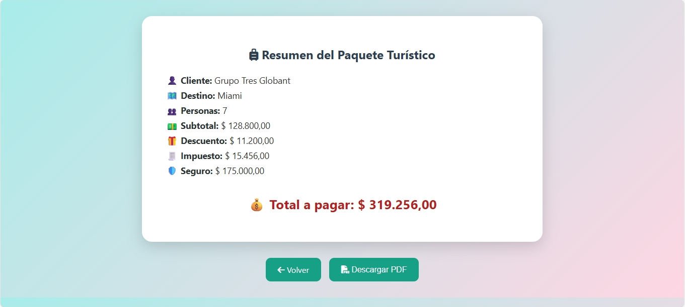

# 🌍 Mundo Aventurero - Planificador de Viajes Turísticos ✈️

Bienvenid@ al repositorio oficial del proyecto **Planificador de Paquetes Turísticos** desarrollado para el examen de agilismo de Globant Dual – Cesde 2025.

> 💡 Este sistema ayuda a la agencia *Mundo Aventurero* a calcular el costo total de viajes, aplicando descuentos, impuestos y seguros opcionales.

---




---

## 📁 Estructura del Proyecto

```plaintext
PlanificadorViajes/
├── .idea/                           
├── apache-tomcat-10.1.42/            # Carpeta del servidor Tomcat descargado
├── lib/                              # Librerías externas
│   └── jakarta.servlet-api-6.0.0.jar # API de Servlets Jakarta (manual)
├── out/                              # Archivos compilados por IntelliJ
├── src/
│   └── PaqueteServlet.java           # Servlet con la lógica del sistema
├── web/
│   ├── index.html                    # Formulario HTML del usuario
│   ├── stars.js			# Efectos Visuales de Estrellas Cayendo en Js
│   ├── style.css                     # Estilos CSS del formulario
│   ├── validation.js	                # Validaciones del Formulario
│   └── WEB-INF/
│       └── web.xml                   # Archivo de configuración del servlet
├── PlanificadorViajes.iml            # Archivo de configuración del proyecto
├── External Libraries/               # Dependencias agregadas al proyecto
└── Scratches and Consoles/           # Consolas y notas del entorno
```

---

## 🧠 Diagrama de Entradas, Procesos y Salidas

📝 Puedes consultar el análisis y diagrama completo en el siguiente documento:

🔗 **[Ver Diagrama Entradas-Procesos-Salidas (PNG)](https://drive.google.com/file/d/1yxKgcrezv12R_EqUM5EpyhaTC7y0QePl/view?usp=sharing)**  

---

## 📊 Asistencia a reuniones grupales

📋 Consulta el documento que contiene la asistencia, fechas de reuniones y pantallazo de soporte:

🔗 **[Ver Excel Asistencia y Pantallazo](https://docs.google.com/spreadsheets/d/1_yZgNt_XuqPY_vEub9Re4O4xjRfNiEs2I3XuvFMkupw/edit?usp=sharing)**  

---

## 🖥️ Activar el Servidor Tomcat en IntelliJ IDEA

1. ✅ En IntelliJ IDEA:
   - Ve a `File > Settings > Application Servers`.
   - Haz clic en `+`, selecciona **Tomcat** y elige la carpeta extraída.
2. ✅ Luego:
   - Ve a `Run > Edit Configurations > + > Tomcat Server > Local`.
   - En `Deployment`, agrega `PlanificadorViajes:war exploded`.
   - En `Application Server`, selecciona el Tomcat configurado.
3. ✅ Ejecuta el servidor con el botón verde del TomCat "Servidor" ▶️.
5. Abre el navegador automaticamente en: http://localhost:8080/PlanificadorViajes/index.html 

---

## ⚙️ Funcionamiento del Sistema

🧾 El formulario HTML solicita:
- Nombre del cliente
- Número de personas
- Destino
- Precio por persona
- Seguro opcional

💸 El sistema calcula:
- Subtotal
- Descuento del 8% si viajan más de 4 personas
- Impuesto del 12%
- Seguro adicional ($25,000 por persona)
- Total final

🔄 Resultado mostrado en pantalla con resumen detallado.

---

## 👥 Integrantes del equipo

- 🧑‍💻 **Mariana Marín Vanegas**
- 🧑‍💻 **Edwin Smith Murillo Murillo**
- 🧑‍💻 **Geraldinne Jaramillo Avendaño**
- 🧑‍💻 **Justin Londoño Cárdenas**
- 🧑‍💻 **Dilan Esteban Villada Mejiao**
- 🧑‍💻 **Mateo Andrés Pineda Beltrán**
- 🧑‍💻 **Dariannys Zambrano**

---


¡Gracias por visitar este proyecto! 😊  
Si tienes preguntas, escríbeme o revisa la documentación adjunta.  
